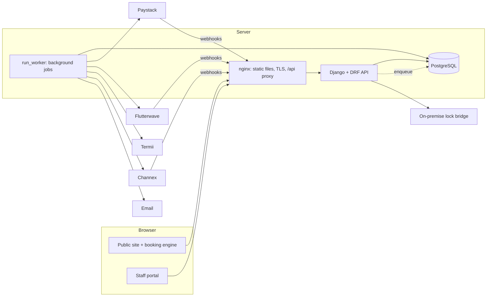
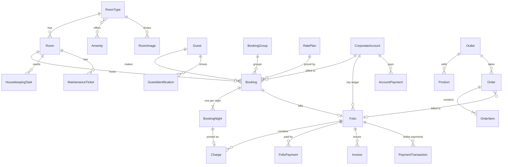
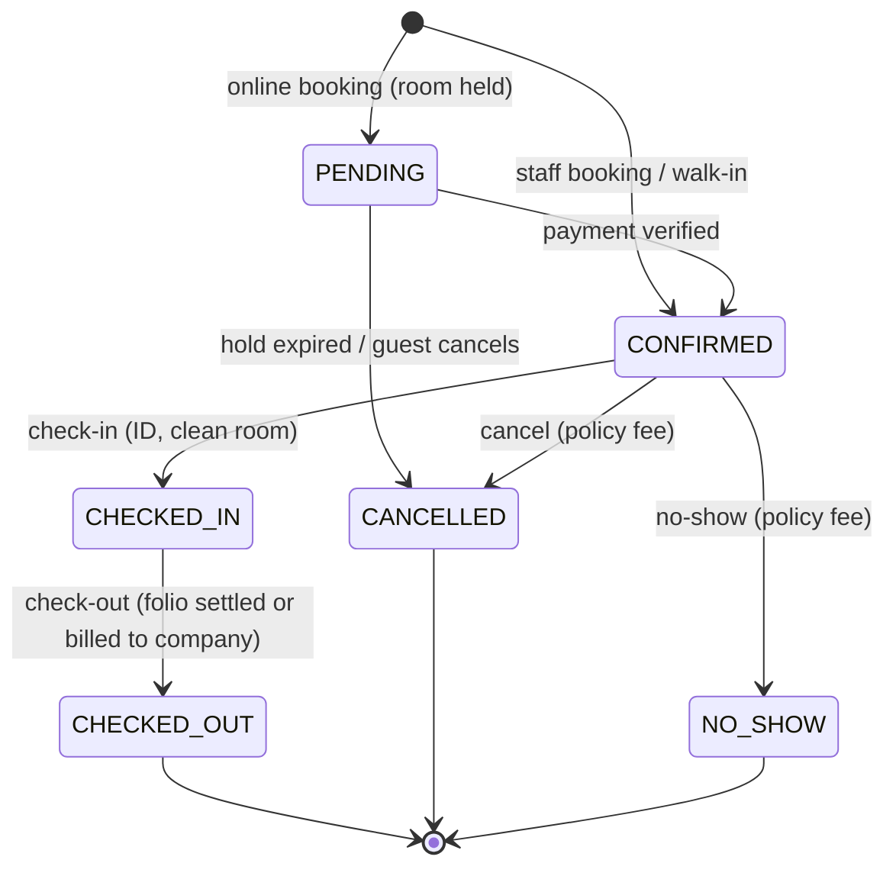

# System overview

This document explains what the Hotel PMS does and how it is built. It is written for a developer joining the project, but the first sections assume no hotel or technical background. For the needs of each kind of user, see [USER_STORIES.md](USER_STORIES.md). For running it in production, see [DEPLOYMENT.md](DEPLOYMENT.md). Security and data protection are covered in [SECURITY.md](SECURITY.md) and [PRIVACY.md](PRIVACY.md).

**Contents**

1. [What the system is](#1-what-the-system-is)
2. [Hotel words you will meet](#2-hotel-words-you-will-meet)
3. [The three faces of the app](#3-the-three-faces-of-the-app)
4. [Features by area](#4-features-by-area)
5. [Architecture](#5-architecture)
6. [Backend apps](#6-backend-apps)
7. [Data model](#7-data-model)
8. [Key flows](#8-key-flows)
9. [Roles and permissions](#9-roles-and-permissions)
10. [API](#10-api)
11. [Background jobs](#11-background-jobs)
12. [Integrations](#12-integrations)
13. [Configuration](#13-configuration)
14. [Frontend](#14-frontend)
15. [Conventions](#15-conventions)
16. [Running, seeding and testing](#16-running-seeding-and-testing)
17. [Known gaps](#17-known-gaps)

---

## 1. What the system is

A **property management system (PMS)** is the software a hotel runs on. It knows every room, every booking and every bill. Staff use it all day: taking reservations, checking guests in and out, charging meals to rooms, cleaning rooms, fixing faults, and closing each day's accounts. Guests use its public website to look at the hotel, book a room and pay.

This PMS is built for **one full-service hotel in Nigeria**: a single property with rooms, a restaurant, a bar, room service and laundry. Several choices follow from that:

- Prices and bills are in Naira (₦), with 7.5% VAT, plus optional service charge and Lagos consumption tax.
- Guests can pay online through **Paystack** or **Flutterwave**, or at the desk by card terminal, bank transfer or cash (including foreign currency).
- Every guest's ID (NIN, passport, driver's licence…) is recorded at check-in. The number is encrypted.
- Guest data is handled under the **Nigeria Data Protection Act 2023** (export, erasure, retention).
- The system works on the assumption that power and internet are unreliable. Nothing at the front desk waits on an outside service: emails, SMS and channel updates run in the background.

It is not a multi-hotel (multi-tenant) SaaS. One installation serves one hotel.

## 2. Hotel words you will meet

| Term | Meaning |
|---|---|
| **Room type** | A category of room with a price and capacity, e.g. "Deluxe Suite". Guests book a room type; the system picks the actual room. |
| **Room** | A physical room with a number, e.g. 203. |
| **Reservation / booking** | One guest's stay in one room for a range of nights. Several rooms booked together form a **group**. |
| **Arrival / departure** | Check-in date / check-out date. A stay of 14→16 Oct is **2 nights** (the 14th and the 15th). |
| **In house** | A guest who has checked in and not yet checked out. |
| **Walk-in** | A guest who arrives without a booking and is booked and checked in on the spot. |
| **No-show** | A guest with a confirmed booking who never arrives. |
| **Folio** | The guest's running bill: room nights, meals, laundry, payments. Called a "bill" in the UI too. |
| **Posting** | Adding a charge to a folio. Room charges are posted one night at a time. |
| **Void** | Cancelling a charge or payment that was posted by mistake. It is never deleted; it is marked void with a reason. |
| **Settle** | Close a folio once it is fully paid. This issues the **invoice**. |
| **City ledger** | Money owed by companies. A guest's bill can be "transferred to the city ledger", meaning the company pays later. |
| **Corporate account** | A company with credit at the hotel (a credit limit and payment terms). |
| **Rate plan** | A way of selling a room: price rules plus conditions. **BAR** (Best Available Rate) is the standard price; other plans are percentages of it (e.g. B&B +12%, non-refundable −15%) or have their own prices. |
| **Restriction** | A selling rule for some dates: stop-sell, closed to arrival or departure, minimum stay. |
| **Rate override** | A manager agreeing a special nightly price for one booking. |
| **Business day / business date** | The hotel's trading day. It ends at **night audit**, not at midnight: a guest arriving at 1am still belongs to the previous day. |
| **Night audit** | The end-of-day close: check that everyone expected has arrived or left, post the night's room charges, freeze the day's figures, open the next day. |
| **Occupancy / ADR / RevPAR** | Standard hotel KPIs: rooms sold ÷ rooms available; room revenue ÷ rooms sold; room revenue ÷ rooms available. |
| **Housekeeping status** | Whether a room is Dirty, Clean or Inspected. A guest can only check in to a clean room. |
| **Out of order / out of service** | A room taken off sale: for repairs (through a maintenance ticket) or longer term (renovation). |
| **Outlet** | A place that sells things: restaurant, bar, room service, laundry. Sales happen in the **POS** (point of sale). |
| **Channel manager / OTA** | Service that sends rooms and prices to online travel agencies (Booking.com, Expedia) and brings their bookings back. |

## 3. The three faces of the app

| Who | Where (local dev) | What it is |
|---|---|---|
| Guests and the public | `http://localhost:3000/` | **Public website**: the hotel, rooms and suites, offers, dining, facilities, gallery, contact. Room detail pages at `/rooms/<slug>`. |
| Guests booking | `/book`, `/book/checkout`, `/booking/payment-complete`, `/booking/manage` | **Booking engine**: search dates, choose a room and rate, enter details, pay online; look up or cancel a booking. |
| Hotel staff | `/login`, then `/dashboard` | **Staff portal**: everything else, with what each person sees depending on their role. |

There is also the **Django admin** (`/admin/` by default; change `DJANGO_ADMIN_URL` in production) for technical staff, and the **API documentation** at `/api/docs/`.

## 4. Features by area

### Public website and booking engine
- Home page with hero slideshow, booking bar, rooms with photos and "rates from" prices, offers, dining, facilities, events, testimonials, gallery with lightbox, contact and policies. Marketing copy lives in `frontend/src/guest/content.ts`.
- Room detail pages with photo gallery, amenities, capacity and a booking box.
- Availability search by dates and party size, showing every bookable rate plan with its total including taxes and its cancellation terms. Promo codes unlock hidden rates.
- Checkout: guest details, marketing consent (never pre-ticked), acceptance of the cancellation policy, then the Paystack or Flutterwave payment page. The room is held for `BOOKING_HOLD_MINUTES` (15) while the guest pays.
- Payment return page that verifies the payment with the gateway before confirming.
- Manage-my-booking: look up by confirmation number + email, see the policy and the fee if cancelled now, cancel.
- If no payment gateway is configured, checkout explains how to book by phone or email instead.

### Reservations
- Staff bookings for one or many rooms (a group), from phone, email, walk-in, corporate, travel agent or OTA.
- Choice of rate plan, company account, a specific room, and (managers only) an agreed nightly rate with a reason.
- Automatic room allocation that never double-books (row locks on the room type during allocation).
- Changing dates, room type, party size or requests, with re-pricing and availability re-checked. In-house guests can extend or shorten.
- Moving a guest to another room, optionally re-pricing the remaining nights.
- Cancellation and no-show under a configurable policy: free until `FREE_CANCELLATION_HOURS` (48) before check-in, then `CANCELLATION_PENALTY_NIGHTS` (1) night. Non-refundable plans forfeit the stay. Staff may waive a penalty with a reason; guests can't.
- Unpaid online holds expire automatically.
- Each night's agreed price is stored separately (`BookingNight`), so later price changes never alter an existing booking.

### Front desk
- Dashboard: today's occupancy, arrivals, departures, in-house count, unpaid holds; check in / check out straight from the lists; walk-in and new-reservation buttons.
- Room board: every room by floor with who is in it, who arrives, who leaves, cleaning status and out-of-order rooms; per-room actions (check in, check out, walk-in, reserve, mark clean); any date.
- Check-in: records an ID document (encrypted), refuses dirty or out-of-order rooms or a room still occupied, opens the folio.
- Check-out: posts any unbilled nights, takes the remaining payment or bills a company, closes the folio with an invoice, marks the room dirty for housekeeping, emails the guest.
- Walk-in: book and check in in one step.
- Key cards: encode and revoke through the door-lock adapter.
- Guest profiles: stays, notes and preferences, VIP flag, ID documents (masked; managers can reveal the full number, which is audited), data export and erasure.

### Billing
- Folios for every stay, and for non-residents (event clients, restaurant guests on account).
- Room nights posted automatically (night audit, check-out, or "update bill"), each night exactly once (database constraint).
- Extras posted by staff or by the POS, with taxes calculated per category and snapshotted on each charge.
- Payments by cash, card terminal or bank transfer, in Naira or foreign currency at the latest exchange rate; online payments land automatically.
- Refunds, voids (with reason and audit), moving a charge to another folio, allowances/discounts.
- Payment links: a gateway checkout URL for an outstanding balance, to send to a guest or company.
- City ledger: bill a folio to a company (credit limit checked), company statements, company payments, ageing.
- Gapless invoice numbering per year (`INV-2026-000123`), immutable invoice snapshots, PDF invoices.

### Rates and distribution
- Rate plans: derived (percentage of BAR) or fixed price per room type and date range; meal plan; public, staff-only, promo-code or company-only; minimum/maximum stay, advance booking window, on-sale dates, refundability, own cancellation window.
- Restrictions by date, room type and plan: stop-sell, closed to arrival or departure, minimum stay. Applied to website and channel bookings; staff see the reason but may still book.
- Seasonal room-type prices (`RoomPricing`) and date-ranged blocks (`RoomAvailabilityOverride`).
- Channel manager (Channex): pushes availability, rates and restrictions; imports OTA bookings (new/modified/cancelled) and flags the ones that can't be placed.

### Operations
- Housekeeping: daily task list generated automatically (departure cleans, stay-over service, rush flag when a guest is due), assignment, start / done / skip (e.g. Do Not Disturb), inspected status, room status grid.
- Maintenance: anyone can report a fault for a room or public area; priority, category, assignment, on hold, resolved with notes; a ticket can take a room out of order until a date and lists the bookings that need moving.
- POS: outlets (restaurant, bar, room service, laundry) with menus by section, stock tracking and low-stock warnings; open orders per table; charge to an in-house guest's room (surname must match) or pay on the spot with a receipt; void with reason. Outlets limit which roles may sell there.

### Management
- Night audit: shows what blocks closing the day, optionally marks remaining arrivals as no-shows, posts room charges, expires holds, freezes the day's flash statistics, opens the next business day.
- Reports: occupancy (actual and on the books), ADR, RevPAR, revenue by department with taxes, payments by method and by staff member (cashier report), guest ledger, city ledger with ageing, POS sales; CSV export.
- Audit log of every sensitive action: sign-ins (and failures), staff changes, bookings, money movements, ID reveals, rate and room changes, night audits, privacy requests.
- Settings: room types and rooms, rate plans and restrictions, outlet menus, tax rates, exchange rates.
- Staff: invite by email (no public sign-up), edit role, deactivate/reactivate, resend invite, reset two-factor.

### Guest communication
- Email always; SMS and WhatsApp through Termii when enabled and the guest hasn't opted out.
- Messages: booking confirmed, pre-arrival reminder, checked out, booking cancelled. Each is sent at most once per booking per channel.

### Security and compliance
- Two-factor sign-in (authenticator app + recovery codes), required for admin, manager and accountant when `ENFORCE_MFA=True`.
- Short-lived access tokens; refresh token in an httpOnly cookie; sessions revoked on password change, deactivation, role change.
- Rate limiting on sign-in, password reset, booking lookup and payment verification.
- Encrypted ID numbers and secrets; no card data ever stored.
- NDPA tooling: export, anonymise, automatic retention.

See [SECURITY.md](SECURITY.md) for the full list.

## 5. Architecture



- **Backend:** Python, Django 6, Django REST Framework, SimpleJWT. PostgreSQL in production, SQLite in development.
- **Frontend:** React 18 + TypeScript, built with Vite, TanStack Query for server state, React Router. One app serves the public site, booking engine and staff portal; staff pages are code-split so guests never download them.
- **Background jobs:** Django's task framework (`django.tasks`) with a database-backed queue in the `jobs` app. No Redis or message broker. In development and tests, tasks run immediately.
- **Deployment:** Docker images, nginx in front, `docker-compose.yml` and CI in `.github/workflows/ci.yml`. See [DEPLOYMENT.md](DEPLOYMENT.md).

The backend is organised as **one Django app per business area**. Inside each app, business rules live in `services.py` (or `lifecycle.py`, `allocation.py`, `pricing.py`…), never in views or serializers. Views validate input, check permissions, call a service and serialise the result.

## 6. Backend apps

| App | Responsibility | Start reading at |
|---|---|---|
| `hotel` | Project settings, URLs, shared building blocks: business date (`clock.py`), money rounding (`money.py`), encrypted fields (`fields.py`), domain errors (`errors.py`), request IDs and JSON logs (`observability.py`), public hotel info endpoint | `settings.py`, `errors.py`, `clock.py` |
| `authentication` | Staff users and roles, capabilities, JWT sign-in with refresh cookie, two-factor (TOTP), password reset, staff management, throttles | `permissions.py`, `views.py`, `mfa.py` |
| `audit` | Append-only audit log and the `record()` helper | `models.py`, `services.py` |
| `rooms` | Room types, rooms, amenities, photos, seasonal prices, availability blocks, public room/availability endpoints, room editing | `models.py`, `services.py` |
| `booking` | Guests, ID documents, bookings, groups, nightly rates. Online and staff reservations, room allocation, pricing, the booking lifecycle (check-in/out, cancel, no-show, modify, move), cancellation policy, front-desk operations, demo seed | `lifecycle.py`, `services.py`, `allocation.py`, `policies.py` |
| `rates` | Rate plans, fixed prices, restrictions, and the rate engine that prices a stay and says why a plan isn't bookable | `engine.py`, `models.py` |
| `billing` | Folios, charges, payments, refunds, taxes, exchange rates, corporate accounts, invoices and PDFs | `services.py`, `taxes.py`, `models.py` |
| `payments` | Online payments: gateway adapters (Paystack, Flutterwave), transactions, verification, webhooks, payment links, gateway refunds | `services.py`, `gateways/` |
| `housekeeping` | Cleaning tasks and room cleaning status | `services.py` |
| `maintenance` | Fault tickets and out-of-order rooms | `services.py` |
| `pos` | Outlets, products, orders, charge-to-room and pay-now, sales report | `services.py` |
| `nightaudit` | Business days, the night audit run, KPI and ledger reports | `services.py`, `reports.py` |
| `notifications` | Guest messages over email/SMS/WhatsApp, templates, periodic reminders | `services.py`, `channels.py`, `templates/` |
| `jobs` | Database-backed task queue and the worker (`run_worker`) with periodic jobs | `backend.py`, `worker.py` |
| `distribution` | Channex channel-manager sync (availability/rates out, bookings in) | `services.py`, `channex.py` |
| `locks` | Door-lock adapters (record-only or on-premise bridge) and key cards | `systems.py`, `services.py` |
| `privacy` | NDPA export, anonymisation and retention | `services.py` |
| `profiles` | Legacy, unused | n/a |

## 7. Data model

The core relationships, simplified:



Things worth knowing:

- **Money is never deleted.** Charges, payments and account payments are voided with a reason. Invoices refuse to be saved twice or deleted. Audit log entries are immutable.
- **Prices are snapshotted.** A booking's nightly rates live in `BookingNight`; a charge stores its taxes in `tax_lines`; an order item copies the product's name and price; an invoice stores a JSON snapshot of the folio.
- **Folio balance** = live charges − (payments − refunds). Positive means the guest owes the hotel; negative means the hotel owes the guest.
- **Booking status** is one of `PENDING` (online, awaiting payment), `CONFIRMED`, `CHECKED_IN`, `CHECKED_OUT`, `CANCELLED`, `NO_SHOW`. Allowed transitions are in `Booking.TRANSITIONS` and enforced by `booking/lifecycle.py`.
- **Room status** (`AVAILABLE`, `OCCUPIED`, `MAINTENANCE`, `OUT_OF_SERVICE`) describes the room tonight. Future occupancy always comes from bookings. Cleaning is a separate field (`DIRTY`, `CLEAN`, `INSPECTED`).
- **Business day:** exactly one `BusinessDay` is `OPEN` (database constraint). `hotel.clock.business_date()` returns it; use it instead of `date.today()` for anything that is about "today" in hotel terms.
- **Database constraints back up the code:** check-out after check-in, at least one adult, non-negative amounts, one live posting per night, one open business day, unique promo codes, and more. A bug in Python can't store an impossible booking.
- Guest ID numbers use `EncryptedTextField`; only the last 4 characters are stored in clear, for display.

## 8. Key flows

### Booking lifecycle



### Online booking and payment
1. The guest searches (`GET /api/rooms/search/`): the rate engine prices each plan for each room type and drops plans that aren't bookable (restrictions, conditions).
2. The guest books (`POST /api/bookings/create/`): `booking.services.create_online_booking` locks the room type, allocates a room, creates a `PENDING` booking with `hold_expires_at`, opens a folio and starts a gateway checkout (`payments.services.start_payment`). The response contains the gateway's checkout URL.
3. The guest pays on Paystack or Flutterwave and is sent back to `/booking/payment-complete?reference=…`.
4. The page calls `POST /api/payments/verify/`. Independently, the gateway calls the webhook. Both paths end in `payments.services.confirm_payment`, which **re-verifies with the gateway** (never trusting the browser or webhook body), checks amount and currency, records the payment on the folio and confirms the booking. It runs under a row lock and is idempotent, so the two paths can race safely.
5. If the payment arrives after the hold expired and the room has gone, the payment is refunded automatically. The transaction is flagged for staff review only if that refund fails.

### Stay and billing
1. **Check-in** (`lifecycle.check_in`): ID recorded if needed, room must be clean and free, booking → `CHECKED_IN`, folio opened, room → `OCCUPIED`, audit entry.
2. During the stay, charges arrive from the POS (charge to room), staff postings, and the **night audit**, which posts each in-house night's room charge (`billing.post_room_charges`, one per `BookingNight`).
3. **Check-out** (`lifecycle.check_out`): posts any unbilled nights, then either settles the folio (balance zero → invoice), transfers it to a company account (city ledger → invoice), or refuses while money is owed (`CHECKOUT_REQUIRES_SETTLED_FOLIO`). Room → `AVAILABLE` and `DIRTY`; guest emailed.

### Night audit
`nightaudit.services.run` closes the open business day:
1. Refuses if a guest due out is still in house, or if arrivals are pending (unless "mark no-shows automatically" is chosen, which applies the no-show fee).
2. Posts tonight's room charge for every in-house guest.
3. Expires lapsed payment holds.
4. Closes the day, freezes its statistics (`reports.flash`) and opens the next day.

Every step is idempotent, so a failed run can be repeated.

### POS sale
Open an order → add items → either **charge to room** (room number + guest surname must match an in-house guest; items posted to their folio) or **pay now** (a one-off folio is opened, items posted, payment recorded, folio settled with a receipt). Stock is consumed at settlement. Orders can be voided before settlement with a reason.

## 9. Roles and permissions

Views check **capabilities**, never role names. The single source of truth is `CAPABILITIES` in `authentication/permissions.py`. The `admin` role (and Django superusers) hold every capability. Managers can't create, promote or manage other managers or admins, and nobody can change their own role or deactivate themselves.

| Capability | Manager | Receptionist | Accountant | Housekeeping | Maintenance | Restaurant / Bar / Laundry |
|---|:-:|:-:|:-:|:-:|:-:|:-:|
| `bookings.view` | ✓ | ✓ | ✓ | | | |
| `bookings.manage` | ✓ | ✓ | | | | |
| `rates.override` (agreed rate) | ✓ | | | | | |
| `guests.view_identity` (reveal ID) | ✓ | | | | | |
| `folios.view` / `folios.post` | ✓ | ✓ | ✓ | | | |
| `folios.adjust` (voids, transfers, allowances) | ✓ | | ✓ | | | |
| `payments.take` | ✓ | ✓ | ✓ | | | |
| `payments.refund` | ✓ | | ✓ | | | |
| `accounts.manage` (city ledger) | ✓ | | ✓ | | | |
| `billing.configure` (taxes, exchange rates) | ✓ | | ✓ | | | |
| `rates.manage` | ✓ | | | | | |
| `rooms.manage` | ✓ | | | | | |
| `housekeeping.view` | ✓ | ✓ | | ✓ | | |
| `housekeeping.work` | ✓ | | | ✓ | | |
| `housekeeping.manage` | ✓ | | | | | |
| `maintenance.view` | ✓ | ✓ | | ✓ | ✓ | |
| `maintenance.report` | ✓ | ✓ | ✓ | ✓ | ✓ | ✓ |
| `maintenance.manage` | ✓ | | | | ✓ | |
| `pos.use` | ✓ | ✓ | | ✓ | | ✓ |
| `pos.manage` / `pos.void` | ✓ | | | | | |
| `reports.view` | ✓ | | ✓ | | | |
| `night_audit.run` | ✓ | ✓ | ✓ | | | |
| `staff.manage` / `audit.view` / `privacy.manage` | ✓ | | | | | |

Each outlet also lists the roles that may sell there (`Outlet.allowed_roles`); managers can sell anywhere. The frontend hides what a user can't do using the `capabilities` list returned by `/api/auth/me/`, but the API is what enforces it.

## 10. API

All endpoints are under `/api/`. JSON in, JSON out. Full, generated reference: `/api/docs/` (requires Django-admin staff).

**Authentication.** `POST /api/auth/login/` with email and password. If two-factor is on, the reply is `{mfa_required, mfa_ticket}` and the code goes to `/api/auth/login/mfa/`. Browsers send `X-Auth-Mode: cookie`: the refresh token is set as an httpOnly cookie on `/api/auth/` and the access token (15 minutes) is returned in the body and kept in memory. `POST /api/auth/refresh/` rotates the session. Other clients get both tokens in the body. Send `Authorization: Bearer <access>`.

**Errors.** Business-rule failures raise `DomainError` subclasses in services, which `hotel.errors.exception_handler` turns into responses: `400 {"field": ["message"]}` or `{"error": "message"}`; `409` for conflicts (room just taken, invalid status change); `403` for forbidden actions. Validation errors use DRF's usual shape.

**Lists** are paginated (`?page=`, 50 per page) unless noted.

| Area | Endpoints |
|---|---|
| Public | `GET hotel/` (name, contacts, times, policy, enabled gateways) · `GET rooms/types/`, `rooms/<slug>/`, `rooms/search/` · `POST bookings/create/`, `bookings/lookup/`, `bookings/cancel/` · `POST payments/verify/` · gateway and Channex webhooks |
| Auth & staff | `auth/login/`, `login/mfa/`, `refresh/`, `logout/`, `me/`, `change-password/`, `password-reset/`, `password-reset/confirm/`, `mfa/setup|enable|disable/` · `staff/` (+ `deactivate`, `reactivate`, `resend-invite`, `reset-mfa`) |
| Reservations | `reservations/` (list with filters `status`, `arrival`, `departure`, `in_house`, `q`; create) · `reservations/<id>/` (get, PATCH to modify) · `reservations/<id>/check-in|check-out|cancel|no-show|move-room|post-room-charges/` · `reservations/summary/` · `front-desk/walk-in/`, `front-desk/room-board/` · `guests/` (+ `identifications`, `reveal`) |
| Rooms | `rooms/all/` · `rooms/all/<id>/` (PATCH) · `rooms/types/<id>/` (PATCH) · `rooms/create/`, `rooms/create-room-type/` |
| Rates | `rates/plans/`, `rates/prices/`, `rates/restrictions/` |
| Billing | `billing/folios/` (+ `charges`, `charges/<id>/void|transfer`, `payments`, `payments/<id>/void`, `refunds`, `settle`, `transfer-to-account`) · `billing/invoices/` (+ `pdf`) · `billing/accounts/` (+ `payments`, `statement`) · `billing/tax-rules/`, `billing/exchange-rates/` |
| Payments | `payments/transactions/` (+ `payment-link`, `refund`) |
| Operations | `housekeeping/tasks/` (+ `generate`, `start`, `complete`, `skip`), `housekeeping/rooms/` (+ `status`), `housekeeping/staff/` · `maintenance/tickets/` (+ `start`, `hold`, `resolve`) · `pos/outlets/`, `pos/products/`, `pos/orders/` (+ `items`, `items/<id>/remove`, `charge-to-room`, `pay`, `void`), `pos/in-house/`, `pos/reports/sales/` |
| Management | `night-audit/` (status + run) · `reports/flash|occupancy|revenue|payments|guest-ledger|city-ledger/` · `audit/` · `distribution/status|sync/`, `distribution/bookings/<id>/resolve/` · `locks/bookings/<id>/keys/` (+ `revoke`) · `privacy/guests/<id>/export|anonymise/` |

## 11. Background jobs

Code enqueues work with Django's task API (`@task` … `.enqueue()`). In production the `jobs` app stores tasks in the database and `python manage.py run_worker` executes them, using `SELECT … FOR UPDATE SKIP LOCKED` so several workers can run safely. With `TASK_BACKEND=immediate` (the default in development and tests) tasks run inline.

Periodic jobs (`PERIODIC_JOBS` in settings), run by the worker:

| Job | Every | Does |
|---|---|---|
| `expire-payment-holds` | 1 min | Cancel unpaid online bookings whose hold has lapsed |
| `pre-arrival-reminders` | 1 h | Email/WhatsApp guests arriving tomorrow (once per booking) |
| `housekeeping-task-list` | 1 h | Generate today's cleaning tasks |
| `channel-pull-bookings` | 2 min | Fetch OTA bookings the webhook may have missed |
| `channel-full-sync` | 6 h | Republish availability, rates and restrictions |
| `privacy-retention` | 1 day | Anonymise long-gone guests; delete old ID documents |

Guest notifications are queued **after the database transaction commits**, so a slow or failing email/SMS provider never blocks or breaks the front desk.

## 12. Integrations

| Integration | Used for | Settings | Notes |
|---|---|---|---|
| **Paystack**, **Flutterwave** | Online checkout, payment links, refunds | `PAYMENT_GATEWAYS`, `PAYSTACK_SECRET_KEY`, `FLUTTERWAVE_SECRET_KEY`, `FLUTTERWAVE_WEBHOOK_HASH`, `PAYMENT_CALLBACK_URL` | A gateway is only offered if its secret key is set. Webhooks are signature-checked; outcomes are always re-verified server-side. |
| **Termii** | SMS and WhatsApp | `SMS_ENABLED`, `WHATSAPP_ENABLED`, `TERMII_API_KEY`, `TERMII_SENDER_ID` | Phone numbers normalised to +234 by default. |
| **Email (SMTP)** | Confirmations, invites, password resets, invoices | `EMAIL_BACKEND`, `DEFAULT_FROM_EMAIL` | Console backend in development. |
| **Channex** | Channel manager for OTAs | `CHANNEX_BASE_URL`, connection set up in the admin | Needs certification against Channex staging before go-live. |
| **Door locks** | Key cards | `LOCK_SYSTEM` (`none` or `bridge`), `LOCK_BRIDGE_URL`, `LOCK_BRIDGE_SECRET` | `bridge` talks to an on-premise HTTP bridge for Visionline / Salto / Onity, signed with HMAC-SHA256. |

## 13. Configuration

All configuration comes from environment variables, read in `hotel/settings.py` (copy `.env.example` to `.env` for development). The ones that change hotel behaviour:

| Setting | Default | Effect |
|---|---|---|
| `HOTEL_NAME`, `HOTEL_ADDRESS`, `HOTEL_PHONE`, `HOTEL_EMAIL`, `HOTEL_TAX_ID` | `Grand Hotel`, empty | Shown on the website, invoices and emails |
| `HOTEL_CURRENCY`, `TIME_ZONE` | `NGN`, `Africa/Lagos` | |
| `HOTEL_CHECK_IN_TIME`, `HOTEL_CHECK_OUT_TIME` | `14:00`, `12:00` | Also the reference time for the cancellation deadline |
| `FREE_CANCELLATION_HOURS`, `CANCELLATION_PENALTY_NIGHTS` | `48`, `1` | Cancellation and no-show policy (rate plans can override the window) |
| `BOOKING_HOLD_MINUTES` | `15` | How long an unpaid online booking holds its room |
| `MAX_STAY_NIGHTS` | `90` | Longer stays must be arranged with management |
| `REQUIRE_GUEST_ID_AT_CHECK_IN` | `True` | Refuse check-in without a valid ID on file |
| `REQUIRE_CLEAN_ROOM_AT_CHECK_IN`, `REQUIRE_ROOM_INSPECTION` | `True`, `False` | Whether a room must be Clean (or Inspected) to check in |
| `CHECKOUT_REQUIRES_SETTLED_FOLIO` | `True` | Refuse check-out while money is owed (unless billed to a company) |
| `INVOICE_PREFIX` | `INV` | Invoice numbers look like `INV-2026-000123` |
| `ENFORCE_MFA`, `MFA_REQUIRED_ROLES` | `False`, admin/manager/accountant | Two-factor enforcement |
| `GUEST_RETENTION_DAYS`, `GUEST_ID_RETENTION_DAYS` | 6 years, 365 days | NDPA retention |
| `FIELD_ENCRYPTION_KEYS` | (required) | Encryption keys for ID numbers and secrets. **Back them up**: data is unreadable without them. |
| `THROTTLE_*` | see settings | Rate limits per endpoint group |

Tax rates, exchange rates, rate plans, room prices and menus are **data**, edited in the staff portal under Settings.

## 14. Frontend

```
frontend/src/
  api/          client.ts (fetch wrapper: auth headers, silent session refresh, ApiError), types.ts
  auth/         AuthContext (current user, capabilities, login/logout, MFA)
  components/   Layout (sidebar, NAV list), ui.tsx (Modal, Field, StatusBadge…), frontDesk.tsx (shared check-in/out, walk-in, edit-stay dialogs)
  guest/        HomePage, RoomPage, GuestSite (booking engine), content.ts (marketing copy), styles
  pages/        one file per staff area: Dashboard, RoomBoard, Reservations, ReservationDetail, NewReservation,
                Guests, Folios, Accounts (companies), Operations (housekeeping + maintenance), Pos, Reports
                (reports, ledgers, night audit), Settings, Admin (staff, audit log, channels), Account, Login
  lib/format.ts money, dates, labels
```

- Server data is fetched with TanStack Query. After an action, the relevant query keys are invalidated so every screen shows fresh data.
- The sidebar (`NAV` in `Layout.tsx`) and route guards (`Guard` in `App.tsx`) use the same capabilities as the API.
- In development Vite proxies `/api` to Django (`API_TARGET`, default `http://127.0.0.1:8000`), so the refresh cookie works exactly as in production (same origin).
- Styling is plain CSS with theme variables in `styles.css` (light and dark).

## 15. Conventions

- **Business rules go in services**, called from views. Services take model instances and keyword arguments, run in `transaction.atomic()`, lock rows they change (`select_for_update`), and raise `DomainError` / `ConflictError` / `ForbiddenError` with a message a user can read.
- **Lock only the row you change.** When a locked query also joins related tables, write `select_for_update(of=('self',))`. PostgreSQL refuses to lock across an optional (nullable) join, and locking the related rows makes unrelated actions wait. SQLite ignores locks entirely, so this class of bug only shows up on PostgreSQL: run the tests against PostgreSQL before relying on a new lock.
- **Every sensitive action is audited** with `audit.services.record(action, request=…, target=…, changes=…)`. Adding an action means adding it to `AuditLog.Action` and a migration.
- **Use the business date** (`hotel.clock.business_date()`), not the calendar date, for anything about the hotel's "today".
- **Money:** `Decimal` everywhere, rounded with `hotel.money.money()` (half-up, 2 places). Never floats.
- **Never delete financial records**; void them with a reason.
- **Permissions:** add a capability to `CAPABILITIES`, check it with `HasCapability('…')`, and expose it to the frontend through `/auth/me/`.
- **Tests sit next to the code** (`tests.py`, `test_*.py` in each app). New behaviour comes with tests; business rules are also guarded by database constraints where possible.

## 16. Running, seeding and testing

```bash
# Backend
python -m venv venv && venv\Scripts\activate      # Windows; use source venv/bin/activate elsewhere
pip install -r requirements.txt
copy .env.example .env                            # set DJANGO_SECRET_KEY and FIELD_ENCRYPTION_KEYS
python manage.py migrate
python manage.py seed_demo                        # demo hotel + two weeks of simulated trading (DEBUG only)
python manage.py runserver                        # http://127.0.0.1:8000

# Frontend
cd frontend && npm install && npm run dev         # http://localhost:3000
```

`seed_demo` creates a 16-room Lagos hotel, staff accounts for every role (password `DemoPass#2026`), guests, companies, rate plans and menus. It then **replays 14 days of operations through the real services**: bookings, check-ins, restaurant and bar sales, payments, check-outs, housekeeping, maintenance, cancellations, no-shows and a night audit each day. The data is therefore consistent, as if staff had used the system. `seed_demo --reset` wipes bookings, bills, orders, tasks, tickets, business days and the audit log (keeping users, rooms and settings) and seeds again.

| Command | What it runs |
|---|---|
| `python manage.py test` | Backend test suite (≈255 tests) |
| `npm test` / `npm run typecheck` (in `frontend/`) | Frontend tests / TypeScript check |
| `python manage.py run_worker` | Background job worker (production) |
| `python manage.py expire_holds`, `apply_retention` | One-off runs of those jobs |

CI (`.github/workflows/ci.yml`) runs on every push and pull request, on a clean checkout with **no `.env`**:

- **Backend:** checks there are no missing migrations, runs the test suite in parallel against **PostgreSQL 16**, then runs Django's production security audit (`check --deploy`) with `DEBUG` off.
- **Frontend:** `npm ci`, TypeScript check, tests and a production build.

Because CI has no `.env`, settings use their defaults there: `DEBUG` is off, so tests run with production hardening (only the HTTPS redirect is skipped under test, as the test client uses plain HTTP), and payment gateways get placeholder keys. If something passes locally but fails in CI, check that every needed file is committed: the Python `.gitignore` template ignores folders named `lib/`, so `frontend/src/lib/` is explicitly re-included.

## 17. Known gaps

- Online payment needs real Paystack/Flutterwave keys and an end-to-end test against the gateways' test mode.
- Channex and the lock bridge need vendor certification before going live.
- Some plain API views are missing from the generated OpenAPI docs.
- Two API features have no screen yet: posting allowances (discounts) and refunding an online payment back to the card.
- Frontend test coverage is thin, and there is no browser end-to-end suite in the repository yet.
- The staff portal has not been tuned for tablets and phones.
- An independent penetration test is planned before go-live.
- The `profiles` app is unused and can be removed.
